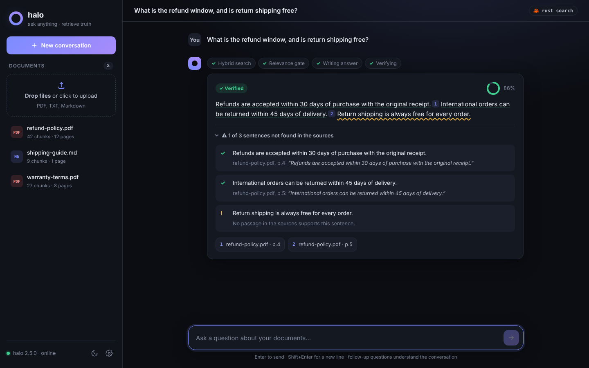
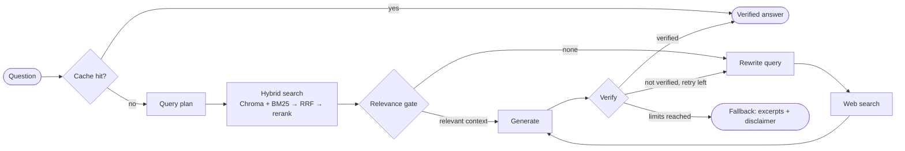

<p align="center">
  
</p>

<p align="center">
  <a href="https://github.com/Nitro-Builds-Yash/halo/actions/workflows/ci.yml"></a>
  <a href="https://github.com/Nitro-Builds-Yash/halo/releases/latest"></a>
  
  
  
  
  
  
  <a href="./LICENSE"></a>
</p>

<p align="center">
  <a href="#-quickstart"><b>Quickstart</b></a> ·
  <a href="#-how-it-works"><b>How it works</b></a> ·
  <a href="#%EF%B8%8F-usage"><b>Usage</b></a> ·
  <a href="#-ai-engineering"><b>AI engineering</b></a> ·
  <a href="#-rust-inside"><b>Rust</b></a> ·
  <a href="#-api"><b>API</b></a> ·
  <a href="#%EF%B8%8F-configuration"><b>Configuration</b></a> ·
  <a href="#-evaluation"><b>Evaluation</b></a> ·
  <a href="#%EF%B8%8F-project-structure"><b>Structure</b></a>
</p>

<br>

**Halo** answers questions about your PDFs, text and Markdown files, and **checks every answer against its sources before returning it**. It finds evidence with hybrid search, filters it with a cross-encoder, searches the web when your documents fall short, and cites where each fact came from. If it still can't verify an answer, it says so and shows you the best evidence instead of guessing.

<br>

<p align="center">
  
  <br><sub>The built-in web app: each sentence linked to its source, an unsupported claim flagged, a hidden instruction in a vendor PDF blocked, and the follow-up search, LLM calls and cost shown.</sub>
</p>

## ✨ Features

<table>
  <tr>
    <td width="33%" valign="top">
      <h3>🔎 Hybrid search</h3>
      Dense vectors (Chroma) and BM25 keyword search, fused with Reciprocal Rank Fusion on shared chunk IDs. It finds both paraphrases and exact codes like <code>§4.1</code>.
    </td>
    <td width="33%" valign="top">
      <h3>⚖️ Relevance gate</h3>
      A cross-encoder scores every chunk. Confident chunks pass, weak ones are dropped, and only the uncertain middle goes to the LLM, in a single batched call.
    </td>
    <td width="33%" valign="top">
      <h3>✅ Verified answers</h3>
      Every answer is checked for grounding and for whether it actually answers the question, including answers built from web results or retries.
    </td>
  </tr>
  <tr>
    <td valign="top">
      <h3>📎 Sentence-level citations</h3>
      Every sentence of an answer points to the exact passage that supports it, with a link to the original page. Sentences no source supports are flagged and lower the confidence score.
    </td>
    <td valign="top">
      <h3>🔁 Self-correction</h3>
      When local context is missing or an answer fails its check, Halo rewrites the query and searches the web, with hard limits so it never loops.
    </td>
    <td valign="top">
      <h3>💬 Follow-up questions</h3>
      Ask "what about international orders?" and Halo rewrites it into a standalone question from the conversation, then searches, caches and verifies that. Verified answers are cached and the cache clears when documents change.
    </td>
  </tr>
  <tr>
    <td valign="top">
      <h3>🧰 Three ways in</h3>
      A <code>halo</code> CLI, a Streamlit app with document management, and a FastAPI server with streaming (SSE).
    </td>
    <td valign="top">
      <h3>🏠 Runs locally</h3>
      Works with OpenAI or any OpenAI-compatible server (Ollama, vLLM, LM Studio), so you can keep everything on your machine.
    </td>
    <td valign="top">
      <h3>🛡️ Built for production</h3>
      Prompt-injection guard, per-answer token and cost tracking with a spend limit, model fallback and routing, Prometheus metrics, LangSmith tracing, Docker and CI.
    </td>
  </tr>
</table>

## ⚡ Quickstart

```bash
git clone https://github.com/Nitro-Builds-Yash/halo && cd halo
pip install -e ".[ui]"                  # add ,rerank for the cross-encoder (installs torch)
pip install ./crates/halo-native        # optional: Rust speed-ups (needs https://rustup.rs + `pip install maturin`)
cp .env.example .env                    # then set OPENAI_API_KEY

halo ingest ./my-docs                   # index .pdf / .txt / .md files
halo serve                              # web app → http://localhost:8000
```

Prefer the terminal? Run `halo` for an interactive chat:

```text
  ◎ halo v2.5.0 · rust (halo-native 0.2.0)

halo › What is the refund window?
🔍 Hybrid retrieval  ⚖️  Relevance gate  ✍️  Answer synthesis  🧪 Verification: useful
╭─ ◆ Verified answer ─────────────────────────────────────────────╮
│                                                                 │
│  Refunds are accepted within 30 days of purchase with the       │
│  original receipt.                                              │
│                                                                 │
╰──────────────────────────────────────── ████████████████░░░░ 86% ╯
  Evidence  every sentence supported by the sources
  ✓ Refunds are accepted within 30 days of purchase with the original receipt.
    policy.pdf p.4: "Refunds are accepted within 30 days of purchase…"
```

<details>
<summary><b>🐳 Run with Docker</b></summary>
<br>

```bash
cp .env.example .env              # add your keys
docker compose -f deploy/docker-compose.yml up --build
```

| Service | URL |
| --- | --- |
| Web app | http://localhost:8000 |
| API docs | http://localhost:8000/docs |
| Streamlit app | http://localhost:8501 |

The API and app share one Chroma server, so documents uploaded in either show up in both. The image includes the Rust keyword-search extension, compiled in a separate build stage. Build a smaller image without torch with `docker compose -f deploy/docker-compose.yml build --build-arg RERANK=0`, or skip the Rust step with `--build-arg NATIVE=0`.
</details>

<details>
<summary><b>☁️ Deploy to Render</b></summary>
<br>

<a href="https://render.com/deploy?repo=https://github.com/Nitro-Builds-Yash/halo"></a>

The [`render.yaml`](./render.yaml) blueprint deploys the API with a 1 GB disk for the index. Render asks for your `OPENAI_API_KEY` (and optionally `TAVILY_API_KEY` and `LANGSMITH_API_KEY`) and generates an `API_KEY` for clients. It uses the Starter plan, because a persistent disk needs a paid instance; the image is built without torch to fit in 512 MB.
</details>

<details>
<summary><b>🔭 Trace every step with LangSmith</b></summary>
<br>

```dotenv
LANGSMITH_TRACING=true
LANGSMITH_API_KEY=lsv2_...
LANGSMITH_PROJECT=halo
```

Each question becomes one trace named `halo`, tagged by where it came from (`api`, `stream`, `cli`, `ui`), with every graph node, LLM call, latency and token count.
</details>

<details>
<summary><b>🏠 Run fully local with Ollama (no OpenAI)</b></summary>
<br>

```bash
ollama pull llama3.1 && ollama pull nomic-embed-text
```

```dotenv
# .env
LLM_BASE_URL=http://localhost:11434/v1
LLM_MODEL=llama3.1
EMBEDDING_MODEL=nomic-embed-text
```

Small local models are less reliable at structured output, so expect more fallback answers than with GPT-4o-mini. Re-ingest your documents after changing the embedding model.
</details>

## 🧠 How it works

<p align="center">
  
</p>

1. **Semantic cache:** a question that closely matches one already answered and verified (cosine similarity ≥ 0.92) is returned immediately.
2. **Query plan:** comparative or multi-part questions are split into up to three focused sub-questions.
3. **Hybrid search:** each sub-question searches Chroma and BM25. Results are fused with RRF and reranked by a cross-encoder.
4. **Relevance gate:** per chunk, a score ≥ 0.85 is kept, < 0.40 is dropped, and anything in between is graded by the LLM in one batched call.
5. **Generate:** the answer is written strictly from the kept context, with citations and a confidence score.
6. **Sentence evidence:** each sentence is matched to the passage that supports it. The model's own labels are re-checked against the passage text, so a wrong number ("60 days" when the source says 30) is flagged as unsupported.
7. **Verify:** two checks, whether every claim is supported by the sources and whether the answer resolves the question. If a checker errors, the answer counts as **not** verified.

When there's no relevant local context, or an answer fails verification, Halo rewrites the query and adds web results (at most one rewrite and one retry). If it still can't verify an answer, it returns the best excerpts with a clear disclaimer.

<details>
<summary>View the graph as Mermaid</summary>
<br>


</details>

## 🧰 AI engineering

| Capability | What it does | Configure |
| --- | --- | --- |
| **Prompt-injection guard** | Every retrieved passage and web page is scanned for instructions aimed at the model ("ignore previous instructions", role markers, exfiltration requests, hidden zero-width text). Matching lines are removed before any LLM sees them, prompts tell the model that passages are data, and the answer reports what was blocked. | `INJECTION_GUARD=sanitize\|flag\|off` |
| **Cost and token tracking** | Every LLM call (including retries and fallbacks) is counted per question: calls, input/output tokens, estimated USD cost by model, latency. Returned as `usage` in every answer, and as Prometheus counters at `GET /metrics`. | `MODEL_PRICES` |
| **Spending limit** | Stops a question before the next LLM call once it has spent its budget, and returns a clear message instead of an unverified answer. | `MAX_COST_PER_QUERY_USD` |
| **Model routing** | Light steps (relevance grading, query planning and rewriting, follow-up condensing, hop planning) run on a cheaper model; answers and verification use the main one. | `FAST_LLM_MODEL` |
| **Model fallback** | If the main model errors, times out or is rate-limited, the call is retried on a backup model, which can be a local Ollama model. | `FALLBACK_LLM_MODEL`, `FALLBACK_BASE_URL` |
| **Agentic multi-hop search** | For multi-part questions, a planner reads what was found and runs up to `MAX_HOPS` follow-up searches for missing facts ("who leads the team that built X, and when did they join?"). | `AGENTIC_SEARCH=auto\|on\|off` |

Example `usage` in a response:

```json
"usage": { "llm_calls": 6, "input_tokens": 9412, "output_tokens": 611, "cost_usd": 0.00178,
           "fallback_calls": 0, "latency_ms": 4300,
           "by_model": { "gpt-4o-mini": { "calls": 6, "input_tokens": 9412, "output_tokens": 611, "cost_usd": 0.00178 } } }
```

Costs are estimates from built-in list prices for common OpenAI models; add or override prices with `MODEL_PRICES='{"model": [input_usd_per_1M, output_usd_per_1M]}'`.

## 🦀 Rust inside

Halo's hot paths are also written in Rust, in [`crates/`](./crates). Halo uses them automatically when they're installed and falls back to identical pure-Python code when they're not.

| Crate | What it does |
| --- | --- |
| [`halo-native`](./crates/halo-native) | PyO3 extension: BM25Plus keyword index and tokenizer, sentence-evidence scoring, Reciprocal Rank Fusion. Releases the GIL and runs in parallel with rayon. |
| [`halo-cli`](./crates/halo-cli) | `haloctl`, a fast native client for the API: streaming answers with evidence, uploads, document management. |

```bash
pip install maturin && pip install ./crates/halo-native   # the extension
cargo install --path crates/halo-cli                     # the haloctl binary

haloctl ask "What is the refund window?"   # or: haloctl chat · haloctl upload a.pdf · haloctl docs
```

Every change is checked in CI: the Rust and Python versions must give **identical** tokens, scores, rankings and evidence (including Unicode text), and `haloctl` is run against a real container.

Measured by [`evals/perf/bench_native.py`](./evals/perf/bench_native.py) in CI (GitHub Actions runner, synthetic 20,000-document corpus, 200 queries):

| Backend | Build index | Query p50 | Query p95 |
| --- | --- | --- | --- |
| Rust (halo-native) | 0.35 s | **0.43 ms** | **0.84 ms** |
| Python (rank-bm25) | 0.41 s | 26.3 ms | 39.2 ms |

Keyword queries are about **60× faster**. Set `HALO_NATIVE=0` to use the Python versions.

## 🖥️ Usage

### Web app

`halo serve` (or Docker) serves the web app at **http://localhost:8000**. You can chat with follow-ups, drag in documents, watch each pipeline step live, hover a sentence to see its source, and open citations at the right PDF page. It has light and dark themes.

### Command line

| Command | What it does |
| --- | --- |
| `halo` | Interactive chat with live pipeline steps and follow-up questions (`new` resets the conversation) |
| `halo ask "question"` | Answer one question and exit |
| `halo ingest ./docs a.pdf` | Index files and folders (`.pdf`, `.txt`, `.md`). Re-ingesting a file replaces it. |
| `halo docs` / `halo docs rm a.pdf` | List indexed documents / remove one |
| `halo serve [--reload]` | Start the API and web app on port 8000 |
| `halo ui` | Start the Streamlit app on port 8501 |
| `haloctl …` | The native Rust client: `ask`, `chat`, `upload`, `docs`, `health` |

### Streamlit app

`halo ui` opens a Streamlit version of the chat where you can upload and delete documents, watch each pipeline step as it runs, and expand the citations, confidence and agent trace for every answer.

## 🔌 API

| Method | Endpoint | Description |
| --- | --- | --- |
| `GET` | `/health` | Service status and capabilities |
| `GET` | `/metrics` | Prometheus metrics: requests by outcome, latency, tokens, cost, cache hits, injection flags, fallbacks |
| `POST` | `/api/v1/query` | Answer a question (semantic cache first) |
| `POST` | `/api/v1/chat/stream` | Server-Sent Events: one status event per step, then the final verified answer |
| `POST` | `/api/v1/documents/upload` | Upload `.pdf` / `.txt` / `.md` files (size-limited) |
| `GET` | `/api/v1/documents` | List indexed documents |
| `GET` | `/api/v1/documents/{source}/file` | The original file; citation `url`s point here (with `#page=N` for PDFs) |
| `DELETE` | `/api/v1/documents/{source}` | Remove a document from both indexes |

```bash
curl -s localhost:8000/api/v1/query \
  -H "Content-Type: application/json" \
  -d '{"question": "What about international orders?",
       "history": [{"role": "user", "content": "What is the refund window?"},
                   {"role": "assistant", "content": "30 days from purchase."}]}'
```

`history` is optional: send earlier messages (oldest first) to ask follow-ups. The response includes the `standalone_question` Halo actually answered.

<details>
<summary>Example response</summary>

```json
{
  "question": "What about international orders?",
  "standalone_question": "What is the refund window for international orders?",
  "generation": "International orders can be returned within 45 days of delivery.",
  "confidence": 0.9,
  "citations": [{ "source": "policy.pdf", "page": 5, "snippet": "international orders: 45 days from delivery",
                  "url": "/api/v1/documents/policy.pdf/file#page=5" }],
  "sentences": [{ "text": "International orders can be returned within 45 days of delivery.",
                  "supported": true, "score": 1.0,
                  "sources": [{ "source": "policy.pdf", "page": 5, "chunk": 2,
                                "snippet": "International orders can be returned within 45 days of delivery.",
                                "url": "/api/v1/documents/policy.pdf/file#page=5" }] }],
  "unsupported_sentences": 0,
  "verdict": "useful",
  "retry_count": 0,
  "rewrite_count": 0,
  "web_search_used": false,
  "is_fallback": false,
  "cached": false
}
```
</details>

If `API_KEY` is set, every `/api/v1/*` request needs an `X-API-Key` header (or `?api_key=`, so citation links open in a browser). Interactive docs are at `/docs`.

## ⚙️ Configuration

All settings live in `.env`; see [`.env.example`](./.env.example) for the full list. The ones you're most likely to change:

| Variable | Default | Purpose |
| --- | --- | --- |
| `OPENAI_API_KEY` | – | OpenAI key (not needed with `LLM_BASE_URL`) |
| `LLM_MODEL` / `EMBEDDING_MODEL` | `gpt-4o-mini` / `text-embedding-3-small` | Models for answers and embeddings |
| `LLM_BASE_URL` | – | Any OpenAI-compatible server, e.g. Ollama |
| `TAVILY_API_KEY` | – | Web search via Tavily (falls back to DuckDuckGo) |
| `TOP_K_RETRIEVE` | `4` | Chunks retrieved per sub-question |
| `GATE_HIGH` / `GATE_LOW` | `0.85` / `0.40` | Relevance-gate thresholds |
| `MAX_REWRITES` / `MAX_REGENERATIONS` | `1` / `1` | Self-correction limits |
| `CACHE_SIMILARITY` | `0.92` | How similar a question must be to reuse an answer |
| `API_KEY` | – | Require `X-API-Key` on the API |
| `CHROMA_HOST` | – | Use a Chroma server instead of local files |
| `LANGSMITH_TRACING` / `LANGSMITH_API_KEY` | `false` / – | Trace every step in LangSmith |

## 📊 Evaluation

Halo includes a real evaluation harness. It runs a **naive RAG baseline** (dense top-k + one generation) and the **full Halo pipeline** on the same questions over your documents, then scores both with [RAGAS](https://docs.ragas.io): faithfulness, response relevancy, context precision and context recall. It also reports fallback rate, web-search rate and latency.

```bash
pip install -e ".[eval]"
halo ingest ./my-docs
cp evals/dataset.example.jsonl evals/dataset.jsonl     # write 30–50 Q&A pairs about your documents
python -m evals.run_eval --dataset evals/dataset.jsonl # results → evals/results/*.json
```

> [!NOTE]
> Benchmark results will be published here once they've been run on a real corpus.

## 🗂️ Project structure

```text
halo/
├── src/halo/                # the Python package
│   ├── agents/              #   LangGraph pipeline: graph, nodes, attribution, conversation
│   ├── rag/                 #   ingestion, Chroma + BM25 indexes, hybrid retriever, reranker
│   ├── api/                 #   FastAPI server
│   ├── web/                 #   web app served at / (HTML, CSS, JS, no build step)
│   ├── ui/app.py            #   Streamlit app
│   ├── core/                #   settings, model clients, cache, tracing, logging
│   ├── tools/               #   web search
│   └── cli.py               #   the `halo` command
├── crates/                  # Rust workspace
│   ├── halo-native/         #   PyO3 extension (BM25, tokenizer, evidence, RRF)
│   └── halo-cli/            #   `haloctl` native client
├── tests/                   # Python tests (LLMs and search mocked)
├── evals/                   # RAGAS quality eval · perf/ Rust vs Python benchmark
├── deploy/                  # Dockerfile, docker-compose.yml
├── docs/                    # images and interview notes
├── render.yaml              # one-click Render deploy
└── pyproject.toml
```

## 🧪 Development

```bash
pip install -e ".[dev]"
pytest            # no API keys needed: every LLM and search call is mocked
ruff check .
```

CI runs lint and the full test suite on every push and pull request. `main` is protected, so changes go in through pull requests with passing checks.

## 📦 Releases

Each release is listed on the [Releases page](https://github.com/Nitro-Builds-Yash/halo/releases) with notes from [`CHANGELOG.md`](./CHANGELOG.md) and a wheel you can `pip install`. To publish a new one, bump `__version__` in `src/halo/__init__.py`, add a section to `CHANGELOG.md`, merge, then run **Actions → Release → Run workflow**.

## 🗺️ Roadmap

- [x] Corrective RAG graph with verification on every answer
- [x] Hybrid search, per-chunk relevance gate, batched grading
- [x] Document management, Docker, local-LLM support
- [x] Real RAGAS evaluation harness
- [ ] Publish benchmark results on a public corpus
- [x] Multi-turn chat (follow-ups rewritten into standalone questions)
- [x] Citations that link to the original document page
- [x] LangSmith tracing and one-click Render deploy
- [x] Sentence-level citations with unsupported sentences flagged
- [x] Rust core: BM25, tokenizer, evidence scoring, rank fusion, `haloctl`
- [x] Built-in web app
- [x] Prompt-injection guard, cost tracking, model fallback/routing, multi-hop search
- [ ] Table extraction and OCR for scanned PDFs

## 📄 License

Released under the [MIT License](./LICENSE).

<p align="center">
  
</p>
