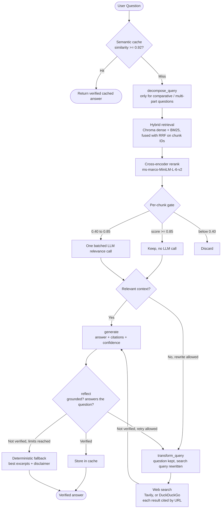

<p align="center">
  
</p>

<p align="center">
  <a href="https://github.com/Nitro-Builds-Yash/halo/actions/workflows/ci.yml"></a>
  
  <a href="./LICENSE"></a>
</p>

<p align="center">
  <strong>Ask anything. Retrieve truth.</strong><br>
  A production-grade Corrective RAG (CRAG) system with autonomous quality gates, hybrid RRF retrieval, fast neural reranker gatekeepers, semantic caching, and strict hallucination reflection.
</p>

---

## 🏛️ System Architecture

Halo models retrieval and verification as a **LangGraph** state machine. Every answer, including ones produced after a web search or a retry, goes through the same verification step before it is returned.



---

## 📊 Evaluation

Halo ships with a real evaluation harness ([`evals/run_eval.py`](./evals/run_eval.py)) that runs **both** a naive RAG baseline (dense top-k + one generation) and the full Halo graph on the same questions over your indexed corpus, then scores them with [RAGAS](https://docs.ragas.io) (faithfulness, response relevancy, context precision, context recall). It also reports the fallback rate, the web-search rate and average latency.

```bash
pip install -e ".[eval]"
python -m src.rag.ingest --dir ./data                       # index your documents
cp evals/dataset.example.jsonl evals/dataset.jsonl          # write 30-50 Q&A pairs about them
python -m evals.run_eval --dataset evals/dataset.jsonl      # results -> evals/results/*.json
```

> Benchmark results will be published here once they've been run on a real corpus.

---

## 🚀 Key Engineering Pillars

1. **Hybrid retrieval (dense + BM25 with RRF)**: dense vectors and BM25Plus keyword search are fused with Reciprocal Rank Fusion ($\text{score} = \sum \frac{1}{60 + \text{rank}}$) on stable chunk IDs, so exact acronyms and section codes are still found.
2. **Per-chunk cross-encoder gatekeeper**: each chunk's sigmoid-normalised cross-encoder score decides whether it is kept, discarded, or sent to the LLM grader, so confident chunks never cost an LLM call.
3. **Single-call batched grading**: borderline chunks are graded together in one structured-output call (`BatchChunkGrading`) instead of one call per chunk.
4. **Verification on every answer, with hard ceilings**: grounding and answer checks run after every generation and fail closed if a grader errors. `MAX_REWRITES` / `MAX_REGENERATIONS` cap the retries, after which a deterministic fallback returns the best cited excerpts.
5. **Real-time SSE streaming**: node-level status events stream as the graph runs, and only the final, verified answer is streamed as the message.
6. **Semantic query cache**: verified, high-confidence answers are reused for near-identical questions. The cache is cleared automatically whenever documents are ingested, so stale answers are never served.

---

## 🛠️ Quickstart & Usage

### 1. Installation
```bash
git clone https://github.com/Nitro-Builds-Yash/halo
cd halo
pip install -r requirements.txt      # full install incl. Streamlit + cross-encoder (torch)
# or: pip install -e ".[ui]"         # lighter, without the reranker
cp .env.example .env                 # add OPENAI_API_KEY (and optionally TAVILY_API_KEY, API_KEY)
python -m src.rag.ingest --dir ./data   # index .pdf / .txt / .md files
```

### 2. Run the Streamlit Dashboard
```bash
streamlit run streamlit_app.py
```

### 3. Run the Interactive Terminal CLI
```bash
python run_cli.py
```

### 4. Run the Production API Server
```bash
uvicorn main:app --reload --host 0.0.0.0 --port 8000
```

### 5. Execute Evaluation & Test Suite
```bash
# Unit tests (no API keys needed - all LLM and search calls are mocked)
pip install -e ".[dev]"
pytest

# Real RAGAS evaluation (see "Evaluation" above)
python -m evals.run_eval --dataset evals/dataset.jsonl
```

---

## 📄 API Endpoints

| Method | Endpoint | Description |
| --- | --- | --- |
| `GET` | `/health` | Service health and capabilities |
| `POST` | `/api/v1/query` | Full CRAG run (semantic cache first) |
| `POST` | `/api/v1/chat/stream` | Server-Sent Events: status per node, then the final verified answer |
| `POST` | `/api/v1/documents/upload` | Upload `.pdf` / `.txt` / `.md` (size-limited); re-uploading a filename replaces its old chunks |

If `API_KEY` is set in `.env`, all `/api/v1/*` routes require an `X-API-Key` header. Allowed browser origins are set with `CORS_ORIGINS`. Every threshold and limit is configurable in `.env` (see [`.env.example`](./.env.example)).

---

## License

Released under the [MIT License](./LICENSE).

<p align="center">
  
</p>
