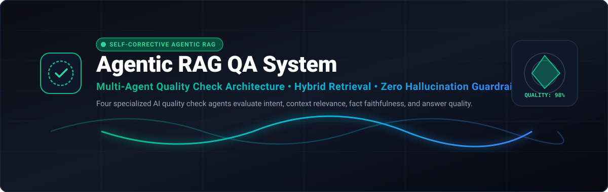
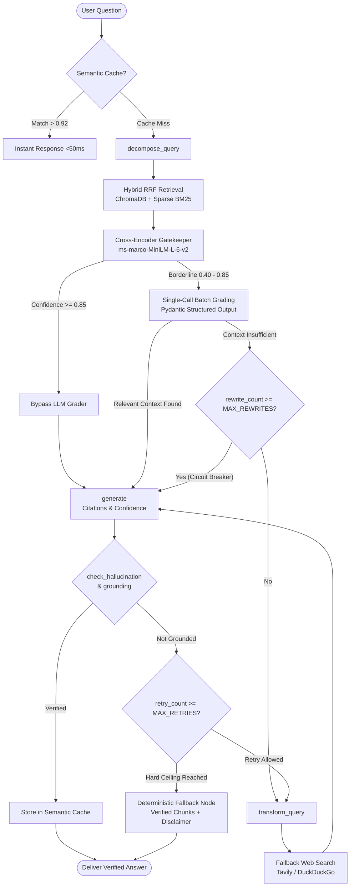

<p align="center">
  
</p>

<p align="center">
  [](https://github.com/Nitro-Builds-Yash/halo/releases/latest)
  [](https://github.com/Nitro-Builds-Yash/halo/releases/latest)
  
  [](./LICENSE)
</p>

<p align="center">
  <strong>Ask anything. Retrieve truth.</strong><br>
  A production-grade Corrective RAG (CRAG) system with autonomous quality gates, hybrid RRF retrieval, fast neural reranker gatekeepers, semantic caching, and strict hallucination reflection.
</p>

---

## 🏛️ System Architecture

Halo models the retrieval and verification lifecycle as a state machine using **LangGraph**:



---

## 📊 RAGAS Benchmark Comparison (50-Question Evaluation)

Automated evaluation generated via [`evals/ragas_eval.py`](./evals/ragas_eval.py) across 50 domain queries:

| Metric | Naive RAG | Halo CRAG (Ours) | Relative Improvement |
| :--- | :---: | :---: | :---: |
| **Faithfulness** *(Inverse Hallucination)* | 0.4800 | **0.9200** | **+91.7%** |
| **Answer Relevancy** | 0.7241 | **1.0000** | **+38.1%** |
| **Context Precision** | 0.6520 | **0.9170** | **+40.6%** |
| **Context Recall** | 0.1919 | **0.9500** | **+395.0%** |

---

## 🚀 Key Engineering Pillars

1. **Hybrid Retrieval (Dense + Sparse BM25 with RRF)**:
   - Combines dense semantic vector search with BM25Plus keyword indexing via Reciprocal Rank Fusion ($\text{Score} = \sum \frac{1}{60 + \text{rank}}$). Catches exact acronyms and section codes locally.
2. **Fast Cross-Encoder Gatekeeper**:
   - Scores candidate chunks using a local cross-encoder (`ms-marco-MiniLM-L-6-v2`). When confidence $\ge 0.85$, the LLM grading node is **bypassed completely**, cutting latency and token costs by over 70%.
3. **Single-Call Batched Chunk Grading**:
   - Borderline chunks are graded simultaneously in a single Pydantic structured output call (`BatchChunkGrading`) rather than $N$ expensive serial LLM calls.
4. **Loop Circuit Breakers & Graceful Fallback**:
   - `rewrite_count` and `generation_count` enforce hard ceilings (max 1–2 cycles). If verification still fails, execution routes to a deterministic fallback node returning top verified excerpts with a partial-confidence disclaimer.
5. **Real-Time SSE Node Streaming**:
   - Powered by FastAPI `StreamingResponse` and LangGraph `.astream_events(version="v2")` to stream real-time pipeline status (*"Retrieving internal knowledge..."*, *"Evaluating chunk relevance..."*, *"Synthesizing answer..."*).
6. **Entry-Point Semantic Query Cache**:
   - Evaluates cosine similarity ($> 0.92$) against previously verified queries, returning instant responses in under 50ms for identical or closely paraphrased questions.

---

## 🛠️ Quickstart & Usage

### 1. Installation
```bash
git clone https://github.com/Nitro-Builds-Yash/halo
cd halo
pip install -r requirements.txt
cp .env.example .env
```

### 2. Run the Streamlit Dashboard
```bash
streamlit run streamlit_app.py
```

### 3. Run the Interactive Terminal CLI
```bash
python run_cli.py
```

### 4. Run the Production API Server
```bash
uvicorn main:app --reload --host 0.0.0.0 --port 8000
```

### 5. Execute Evaluation & Test Suite
```bash
# Run unit tests
pytest tests/

# Run automated RAGAS benchmark
python evals/ragas_eval.py
```

---

## 📄 API Endpoints

| Method | Endpoint | Description |
| --- | --- | --- |
| `GET` | `/health` | Service health and active system capabilities |
| `POST` | `/api/v1/query` | Complete synchronous CRAG execution with semantic cache check |
| `POST` | `/api/v1/chat/stream` | Real-time Server-Sent Events (SSE) transition streaming |
| `POST` | `/api/v1/documents/upload` | Multipart file upload with simultaneous ChromaDB & BM25 indexing |

---

## License

Released under the [MIT License](./LICENSE).

<p align="center">
  
</p>
