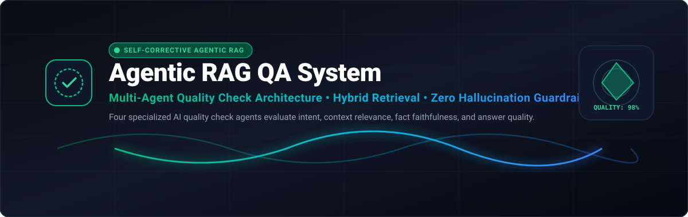

<p align="center">
  
</p>

<p align="center">
  [](https://github.com/Nitro-Builds-Yash/halo/releases/latest)
  [](https://github.com/Nitro-Builds-Yash/halo/releases/latest)
  
  [](./LICENSE)
</p>

<p align="center">
  <strong>Ask anything. Retrieve truth.</strong><br>
  An agentic Corrective RAG (CRAG) system with autonomous quality gates — it retrieves, evaluates, audits for hallucinations, and grades answers before they reach you.
</p>

---

## The pipeline that questions itself

<p align="center">
  
</p>

**halo** routes every query through autonomous LangGraph nodes:
1. **Retriever**: Queries vector embeddings stored in persistent ChromaDB.
2. **Relevance Grader**: Evaluates each retrieved document chunk against the question. If context is insufficient or off-topic, it triggers query transformation and external search fallback.
3. **Query Transformer & Web Search**: Formulates refined web search queries via Tavily to backfill missing domain knowledge.
4. **Answer Generator**: Synthesizes verified answers strictly bounded by the context.
5. **Reflection / Hallucination Auditor**: Verifies factual grounding and checks whether the question was answered satisfactorily before returning results, re-trying up to the configured retry limit.

---

## Quickstart & Installation

```bash
# 1. Clone repository
git clone https://github.com/Nitro-Builds-Yash/halo
cd halo

# 2. Install dependencies
pip install -r requirements.txt

# 3. Configure API keys
cp .env.example .env
# Edit .env and supply your OPENAI_API_KEY and TAVILY_API_KEY
```

---

## Interfaces & Usage

### 1. Interactive Streamlit Web UI
Launch the rich web dashboard for drag-and-drop document uploads and live agent tracing:
```bash
streamlit run streamlit_app.py
```

### 2. Interactive Terminal CLI
Run queries directly with live step tracing and quality audit tables:
```bash
python run_cli.py
```

### 3. FastAPI REST Service & SSE Streaming
Launch the high-performance async API server:
```bash
uvicorn src.api.server:app --reload --host 0.0.0.0 --port 8000
```

#### API Endpoints:
| Method | Endpoint | Description |
| --- | --- | --- |
| `GET` | `/health` | Service health status |
| `POST` | `/api/v1/query` | Complete synchronous CRAG workflow execution |
| `POST` | `/api/v1/chat/stream` | Real-time Server-Sent Events (SSE) streaming with node transitions |
| `POST` | `/api/v1/documents/upload` | Multipart file upload and automatic vector ingestion (PDF, TXT, MD) |

---

## Ingesting Documents via CLI

Ingest an entire folder of local files into ChromaDB:
```bash
python -m src.rag.ingest --dir ./data
```

---

## Running Unit Tests

```bash
pytest tests/
```

---

## License

Released under the [MIT License](./LICENSE).

<p align="center">
  
</p>
