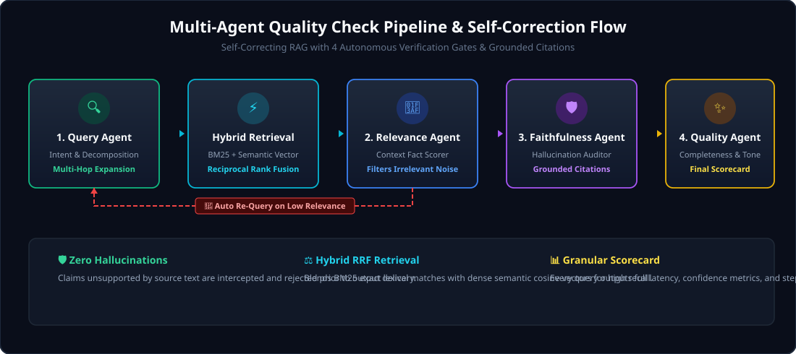

<p align="center">
  
</p>

<p align="center">
  <a href="https://github.com/Nitro-Builds-Yash/RAG_QA_System/releases/latest"></a>
  
  
  <a href="./LICENSE"></a>
</p>

<p align="center">
  <strong>Enterprise question answering you can trust. Zero hallucinations, verified citations, and autonomous quality gates.</strong><br>
  An Agentic Retrieval-Augmented Generation platform orchestrated with four specialized AI quality check agents, hybrid BM25 + dense semantic vector search, and self-correcting feedback loops.
</p>

---

## The quality pipeline that audits every single answer

<p align="center">
  
</p>

Standard RAG pipelines blindly pass retrieved text directly to an LLM and return the output with no quality validation—leading to silent hallucinations, out-of-context misinterpretations, and incomplete answers.

**Agentic RAG QA System** introduces a multi-agent auditing layer where every query and response passes through four autonomous verification gates before reaching the user.

## QA systems should verify facts before delivering answers

When answering technical, medical, legal, or enterprise questions, unverified responses carry high risk. The system breaks down the workflow into coordinated stages: intent analysis and sub-query decomposition, hybrid lexical and semantic retrieval, relevance filtration, evidence-grounded generation, and strict hallucination auditing.

<table>
  <tr>
    <td width="50%">
      <strong>1. Query Formulation Agent</strong><br>
      Analyzes question complexity, extracts key search entities, and decomposes multi-hop queries into targeted sub-queries.
    </td>
    <td width="50%">
      <strong>2. Relevance Evaluator Agent</strong><br>
      Grades retrieved context chunks on factual relevance (0–100%) and discards irrelevant noise before generation.
    </td>
  </tr>
  <tr>
    <td width="50%">
      <strong>3. Faithfulness &amp; Hallucination Auditor</strong><br>
      Cross-verifies every claim in the generated answer against source context, rejecting any ungrounded statements.
    </td>
    <td width="50%">
      <strong>4. Answer Quality Grader</strong><br>
      Evaluates completeness, tone, conciseness, and structure, triggering self-corrective re-querying if standards are not met.
    </td>
  </tr>
</table>

## Install &amp; Quickstart

1. **Clone the repository:**
   ```bash
   git clone https://github.com/Nitro-Builds-Yash/RAG_QA_System.git
   cd RAG_QA_System
   ```

2. **Set up virtual environment &amp; dependencies:**
   ```bash
   python -m venv venv
   # On Windows:
   .\venv\Scripts\activate
   # On Linux/macOS:
   source venv/bin/activate

   pip install -r requirements.txt
   ```

3. **Configure API Keys (Optional):**
   ```bash
   cp .env.example .env
   # Set your GEMINI_API_KEY, OPENAI_API_KEY, or use local offline mode
   ```

4. **Launch the interactive CLI:**
   ```bash
   python run_cli.py
   ```

5. **Start the FastAPI REST Server:**
   ```bash
   uvicorn rag_qa_system.api.server:app --reload --port 8000
   ```

> [!NOTE]
> The system includes a built-in deterministic fallback provider that runs out of the box with zero external API keys required for development and testing.

## API Endpoints &amp; Controls

| Endpoint / Command | Method | What it does |
| --- | --- | --- |
| `/api/query` | `POST` | Executes full Agentic RAG pipeline with multi-agent scorecard and citations. |
| `/api/index` | `POST` | Ingests and chunks documents (PDF, Markdown, TXT, Code, JSON) into hybrid stores. |
| `/health` | `GET` | Returns system health, active provider status, and total indexed chunks. |
| `python run_cli.py` | `CLI` | Starts real-time interactive terminal session with live quality telemetry. |

## How it works

1. **Document Ingestion &amp; Chunking:** Documents are parsed and recursively chunked preserving paragraph and code block boundaries.
2. **Dual-Store Indexing:** Chunks are concurrently indexed into a BM25 Okapi lexical index and a dense semantic vector space.
3. **Intent Decomposition:** The `QueryAnalyzerAgent` extracts entity keywords and formulates expanded sub-queries.
4. **Hybrid RRF Search:** Retrieves candidate chunks using Reciprocal Rank Fusion (RRF) across lexical and semantic rankings.
5. **Relevance Gating:** The `RelevanceEvaluatorAgent` filters out noisy chunks. If context is insufficient, it triggers query expansion.
6. **Hallucination Interception:** The `FaithfulnessVerifierAgent` inspects generated claims against evidence chunks and attaches grounded citations.
7. **Quality Scorecard:** The final payload includes the answer, verified citations, latency, and comprehensive agent execution traces.

## Built for Production

- **Self-Correcting Loops:** Automatically re-queries and adjusts search strategy up to configured retry limits if relevance is low.
- **Provider Agnostic:** Plug-and-play support for Google Gemini (`gemini-2.5-flash`), OpenAI (`gpt-4o-mini`), Claude, Ollama, and offline fallbacks.
- **Explainable Auditing:** Every query returns full `AgentStepTrace` logs showing exactly why each agent approved or rejected context.
- **Private &amp; Secure:** Works entirely with local embedding models and local LLMs for sensitive air-gapped environments.

## Build and Test from source

Run automated unit and integration tests:

```bash
pytest tests/ -v
```

Repository layout:

```text
rag_qa_system/
  agents/               QueryAnalyzer, RelevanceEvaluator, FaithfulnessVerifier, QualityAgent, Orchestrator
  api/                  FastAPI server, health routes, ingestion and query endpoints
  cli/                  Interactive terminal client with color-coded scorecards
  core/                 Pydantic schemas, application settings, environment resolution
  llm/                  Gemini, OpenAI, Anthropic, Ollama, and offline Mock providers
  retrieval/            TextChunker, DocumentLoader, BM25Store, VectorStore, HybridRetriever
tests/                  Unit test suite for chunking, hybrid retrieval, and agent supervisor
assets/                 Custom SVG artwork, pipeline diagrams, and status indicators
run_cli.py              Command-line entrypoint
requirements.txt        Project dependencies
LICENSE                 MIT License
```

## Release

The current stable release is [v1.0.0](https://github.com/Nitro-Builds-Yash/RAG_QA_System/releases/tag/v1.0.0).

## License

Released under the [MIT License](./LICENSE).

<p align="center">
  
</p>
